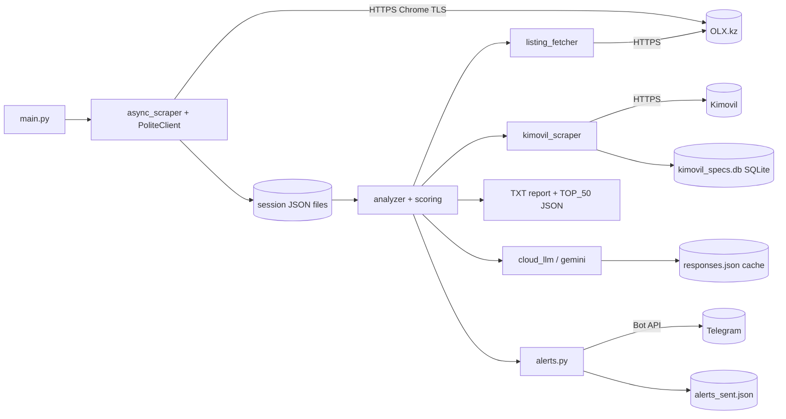

# System design review: olx-phone-scout

Kind: one-shot CLI (single user, run by hand or by cron/systemd timer with `--notify`). No server, no DB server, no cache server. Flow, branches and known bugs: [logic-map.md](logic-map.md). Not repeated here.

## Assumptions (label: measured / assumed)

- Users: 1 (the owner). Runs: ~1/day when on a timer, otherwise ad hoc. Assumed: git log shows 32 commits, last 8 active days 2026-10-21..11-05 (measured, `git log`), no run-frequency log exists.
- Listings per session: 2310 (`alma-ata_90k-380k_android`), 3478 (`alma-ata_15k-80k_both`), 7226 (`alm_15k-80k_both_shops`, the largest) (measured, `data/sessions/*/results/all_listings.json`).
- OLX card page ~20 cards => widest session needs ~360 page fetches at 7226 listings (assumed 20 cards/page; OLX cap 1000 results = 25 pages per slice, logic-map step 1).
- Pacing: `DEFAULT_REQUEST_DELAY` 1.5 s, PoliteClient delay 0.75-1.5 s, 2 retries (measured, `src/core/constants.py:10`, `src/core/async_scraper.py:41,118-121`).
- Kimovil: concurrency 2, 2.5 s delay (measured, `constants.py:24-25`). Specs cache has 260 rows (measured, `data/cache/kimovil_specs.db`, read-only).
- Data dir: 52 MB sessions + 6.4 MB cache; largest single file `androids_analyzed.json` 12.4 MB (measured, `du`, `ls`).
- LLM: opt-in only; top 50 phones per run max (`TOP_RECOMMENDATIONS_COUNT` 50), one call per phone, cached by MD5(title+price) (measured, logic-map step 7).
- Latency target: none; a run may take minutes. Assumed 15 min is fine. Availability: not applicable (batch). Durability: results are re-scrapable; only `alerts_sent.json` and verdict caches are state worth keeping.

## 0. What exists

Python 3.12 CLI (`main.py`), asyncio, `PoliteClient` (market-sources) over curl_cffi Chrome TLS transport, selectolax, loguru, SQLite only for the Kimovil spec cache, everything else is JSON files per session. No queue, no web server, no deploy artefact in the repo besides `run.sh`.
Ladder rung today: rung 0/1, a single process on a single machine, files as storage. Correct for the load.

## 1. Requirements

One sentence: turn an OLX.kz price range in one city into a ranked, scored list of used phones, optionally alert new top-10 entries in Telegram.
Functional: scrape + dedupe; classify brand; score by market price/specs/condition; optional LLM defect verdict; report + alert. Out of scope: multi-user, multi-marketplace, real-time prices (roadmap), serving a UI.
NFR that actually bind: politeness to OLX and Kimovil (an IP block ends the tool), survival of OLX/Cloudflare fingerprint changes, idempotent re-runs, free-tier LLM quotas.

## 2. Napkin math

Model the run as "requests" of one pipeline, not DAU. Scrape ~360 pages + top-50 detail pages + <=30 new Kimovil models + <=50 LLM calls is ~480 outbound requests per run (assumed from the numbers above).

```
$ napkin.py --dau 1 --req-per-user 480 --peak 1 --server-rps 1 --object-kb 12 --write-kb 3 --response-kb 150 --retention-years 1 --read-share 0.99
requests/day 480 ; average 0.0 req/s ; app servers 2 (formula floor, meaningless for a CLI)
```

Script verdict for the earlier 1500 req/day variant: "rungs 1-2: one good VPS. Ship it", storage 197 MB/year at x3 replication, egress 20 kbit/s. Real numbers are lower: nothing is replicated.

Hand-derived wall time (assumed, the script has no batch mode; arithmetic done with python, not in head): the scrape is paced at ~1.1 s average per request per client, 360 pages => `python3 -c "print(360*1.1/60)"` = 6.6 min if serial; with concurrency inside PoliteClient it is bounded below by the pacing. The Kimovil leg: 30 models * 2.5 s / 2 slots = 37 s. Details for top 50 are unpaced (see Risks).

Conclusion: the load is ~500 outbound requests per run, 0 inbound. No capacity problem on any rung. The constraint is remote tolerance, not our CPU.

## 3. API contract

n/a (no server). CLI contract: see `main.py` flags in logic-map "Entry points". Exit codes 0/1/2.

## 4. Architecture



Every box is on the rung: one process, local files, SQLite where a key lookup needs it. No queue or DB server is justified; adding one would cost more than it saves at ~500 requests/run.

## 5. Data

- Access pattern: whole-file read, whole-file rewrite per run; lookups by link (dict in memory) and by model (SQLite PK). Single writer.
- Files: `all_listings.json` (merge-only, grows forever, logic-map #3), `androids_analyzed.json` (12.4 MB on the widest session, written with `indent=2`), `responses.json` caches.
- SQLite `phone_specs` (260 rows): right engine, PK lookup. Fine.
- Cache pattern: cache-aside on disk. Kimovil: only successes cached, no TTL (specs of a released phone do not change; fine). LLM cache keyed MD5(title+price), no TTL: stale on description change (logic-map #9).
- Growth (measured size / assumed rate): sessions total 52 MB, the widest session 22 MB. At 1 run/day with merge-only growth and re-parsed whole JSON, a 7k-listing session is ~12 MB analyzed file; parse+dump of that is sub-second to seconds. Stays fine until ~100 MB per file (assumed), years away at this scan size.
- Log volume: the largest session logs dir is 6.0 MB for one session (measured); rotation constants live in `infrastructure/logging` (logic-map "Logging").

## 6. Scale and failure

x10 traffic (70k listings, or ten sessions): what breaks first is OLX pacing, not CPU. 3600 pages * ~1.1 s = ~66 min of paced requests, and rising block risk. Computed: `python3 -c "print(3600*1.1/60)"` = 66. Second: JSON rewrite of a 120 MB file per run. Next rung trigger: see 8.

Failure table:
- OLX 403 (TLS fingerprint drift): page skipped, run continues with fewer listings; count-request failure ends the scrape with empty result (logic-map step 1). Detect by 0 new listings.
- Kimovil 429 / Cloudflare: that model gets None, scoring falls back to title-only; no breaker, so a blocked IP still gets every model attempted each run (bounded: 2 concurrent, 2.5 s).
- Cloud LLM down: Gemini fallback if enabled, else phone keeps its score. 8 s upstream = latency only; no circuit breaker, but call count <=50.
- Machine gone: state lives in `data/`; no backup. Losing it loses `alerts_sent.json` (duplicate alerts once) and caches (re-scrape cost). Acceptable.
- Crash mid-write: `json.dump` straight into the target file (`async_scraper.py:490`, `analyzer.py:1010,1026`, `cache.py:58`). A kill during dump truncates the file; next run merges from a corrupt file.
- Retries: page level 2 retries with backoff via PoliteClient; details fetch none; rate limits are self-imposed delays.

## 7. Trade-offs

- JSON files over a DB: simplest, human-greppable, no migrations; costs atomicity, concurrent-run safety and query speed. Right at one user.
- Impersonating Chrome TLS over official APIs: only working path to OLX/Kimovil; costs fragility to anti-bot changes (`IMPERSONATE`, CLAUDE.md "Known limitations").
- Merge-only listings: cheap dedupe; costs stale/sold ads in ranking (logic-map #4).
- Aggressive concurrent page fetch vs politeness: speed vs ban risk; current choice leans on PoliteClient pacing.
- Free-tier LLMs: cost 0; costs quota/latency variance and verdict cache coarseness.

## 8. Summary

Design: a single-process async batch CLI, JSON files per session plus one SQLite spec cache, politely paced outbound scraping, optional LLM, Telegram alert. It holds its real load (~500 outbound requests and ~10 MB of JSON per run) with orders of magnitude of headroom.
Assumptions that change it: runs per day (many per day raises ban risk first); session width (>20k listings per session makes pacing, not CPU, the limit); a second user or second host (then files need a DB).
Next rung: SQLite (rung 1 storage) instead of JSON when any session file passes ~100 MB or two runs overlap (a lock/collision is observed); queue/workers never, unless scraping is parallelised across IPs.

## Risks

- HIGH, FIXED 2026-11-05 (uncommitted; `write_json_atomic` in `src/infrastructure/atomic.py`), was: `src/core/async_scraper.py:490,510-519`, `src/analysis/analyzer.py:1010,1026`, `src/infrastructure/cache.py:58`: non-atomic overwrites of state files (`all_listings.json`, `androids_analyzed.json`, caches). A kill or full disk (root partition is tight on this machine) truncates data; merge then reads garbage. Fix: write temp file + `os.replace`.
- MEDIUM, `src/fetchers/listing_fetcher.py:82,264`: top-50 detail fetch is gathered without pacing or retry (logic-map step 6), the only unpaced burst against OLX; the most likely trigger of an IP block that also stops scraping.
- MEDIUM, `src/core/async_scraper.py:235-252`: slice count request failure is uncaught and returns `([], [], [])`, silently turning a transient error into an "empty" run; exit code depends on `len(androids) > 0` (logic-map #6).
- MEDIUM, `data/sessions/*`: no concurrency guard. A cron run overlapping a manual run on the same session interleaves rewrites of the same JSON files. Add a lockfile per session.
- MEDIUM, no breaker for Kimovil/OLX blocks: every run re-hammers a blocked host with the full request set (bounded by pacing, still wasted). Stop the stage after N consecutive 429/403.
- LOW, `merge_with_existing` (`async_scraper.py:410`): unbounded growth of `all_listings.json` (logic-map #3). 7226 listings now; fine until ~100 MB.
- LOW, no backup of `alerts_sent.json`/caches (`data/` is only on this host); loss costs duplicate alerts and a re-scrape.
- LOW, no run metrics (duration, pages fetched, 403 count) in a machine-readable form; "what breaks first" is only visible in logs. Add one summary line/JSON per run.
